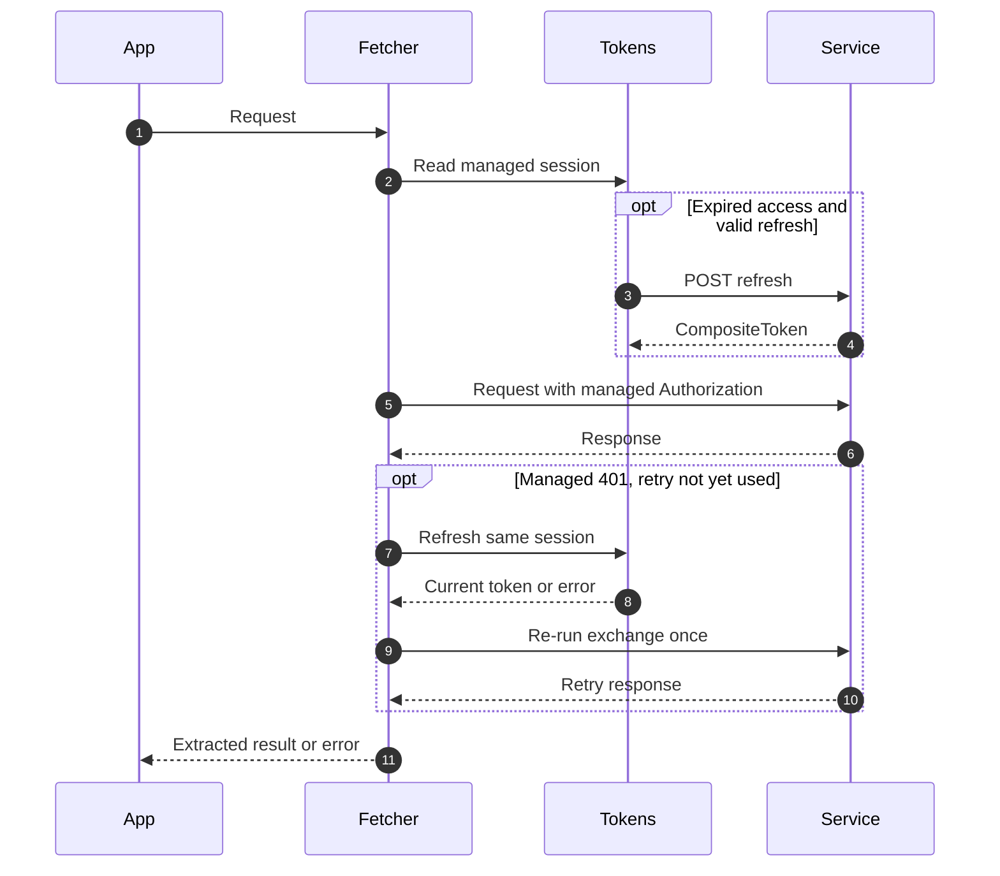

# Interceptors and attribution

These interceptors enrich or retry a FetchExchange. Register each with the matching request, response or error manager using `.use(instance)`. The [configurer](./configuration) installs the common combination.

## Actual execution flow

1. CoSecRequestInterceptor skips a request that [`isTrusted`](#request-trust) rejects; otherwise it sets the device and request headers (no `CoSec-App-Id`: CoSec 8.0 does not read one, the app is the token's `aud`) and a truthy resolved space ID. The refresh call (an exchange carrying `Ignore-Refresh-Token`) is never spaced: it carries the expired access token, which CoSec reads as anonymous, and an anonymous request that declares a space is refused `401` (`SCP-3`). The space is resolved once per exchange: a 401 retry is sent to the space the request was first sent to, even if the current space changed during the refresh; later requests use the current space.
2. AuthorizationRequestInterceptor skips an untrusted request (no Authorization, no refresh) and preserves an existing Authorization header; otherwise it checks session ownership, refreshes when access is expired and refresh is valid, then injects the managed Bearer token. A request with no token to send does not send the `CoSec-Space-Id` the CoSec interceptor set, for the same reason.
3. ResourceAttributionRequestInterceptor fills tenant/owner URL path parameters before URL resolution, looking for the placeholders in the template the request is resolved from: the Fetcher `baseURL` joined with the request URL, or the request URL alone when it is absolute. The core transport sends the request.
4. AuthorizationResponseInterceptor handles a managed-credential 401 before normal status validation. The 401 of a request `isTrusted` rejected (sent without this application's credentials) is returned as is: no refresh, no replay, no onUnauthorized. For a managed 401 it first reads the [problem](#cosec-problems): `unauthorized` (no credential was seen) is not refreshed; `token-revoked` and `token-invalid` are not refreshed either, since the session ended or the credential is not accepted: the stored pair is removed if it is still the one that was sent, and the exchange that removed it is the one that notifies. `token-expired`, and a 401 with no CoSec problem, go on: it releases the unread 401 body (so it holds no connection the refresh and retry need), refreshes, deletes only its injected stale credential, and re-executes the full exchange pipeline at most once. The retry's own outcome replaces the 401: if its fetch fails (offline, timeout, abort), the request fails with that error, `exchange.response` is undefined and onUnauthorized is not called. A request whose body is a `ReadableStream` (or another async iterable) cannot be sent again: the session is still refreshed, and the request fails with `NonReplayableRequestError` (not notified) so the caller can re-send it with a new body.
5. Remaining failures reach error interceptors. Unauthorized handles 401/RefreshTokenError with notification ownership guards (a `RefreshUnavailableError` — the refresh gave no verdict — keeps the session and is not notified) and passes the problem; Forbidden handles 403 and routes `scope-rejected` to its own callback. A `429`, `503`, `500` and `400` reach neither: the request rejects with the status error, whose problem `getCoSecProblem` reads. Neither callback automatically recovers the failed request.

The request/response managers sort order values; registration order alone is not the execution contract. Re-executing the pipeline can create a new CoSec request ID. Caller-provided Authorization values are not replaced or automatically refreshed. A token may still be attached when access is expired and refresh is unavailable; the server decides the resulting status.



## Interceptor parameters and results

| Export                                                                 | Constructor options                                                                                                           | intercept(exchange)                                                                                                                                                                                                                                         |
| ---------------------------------------------------------------------- | ----------------------------------------------------------------------------------------------------------------------------- | ----------------------------------------------------------------------------------------------------------------------------------------------------------------------------------------------------------------------------------------------------------- |
| `CoSecRequestInterceptor` / `CoSecRequestOptions`                      | deviceIdStorage required; spaceIdProvider defaults NoneSpaceIdProvider; optional isTrusted; `appId` is deprecated and ignored | Promise&lt;void&gt;; nothing for an untrusted request; otherwise overwrites device/request headers; writes space only for a truthy ID, and not on the refresh call; storage/provider failures propagate                                                     |
| `AuthorizationRequestInterceptor` / `AuthorizationInterceptorOptions`  | tokenManager required (JwtTokenManagerCapable); optional isTrusted                                                            | Promise&lt;void&gt;; nothing for an untrusted request; preserves explicit Authorization, refreshes managed token when needed                                                                                                                                |
| `AuthorizationResponseInterceptor`                                     | Same AuthorizationInterceptorOptions                                                                                          | Promise&lt;void&gt;; only 401 of a trusted request, only matching managed credential, at most AUTHORIZATION_RESPONSE_MAX_RETRY=1; no refresh for `unauthorized`, `token-revoked`, `token-invalid`; a one-shot body fails with NonReplayableRequestError     |
| `ResourceAttributionRequestInterceptor` / `ResourceAttributionOptions` | tokenStorage required; tenantId='tenantId', ownerId='ownerId' are **placeholder names**                                       | void; takes tenantId/sub from decoded access payload; fills matching template fields of the baseURL + request URL template (the request URL alone when absolute) only when current path value is falsy                                                      |
| `UnauthorizedErrorInterceptor` / options                               | onUnauthorized(exchange, problem?) required, returns void or Promise&lt;void&gt;                                              | void or Promise&lt;void&gt;; skips RefreshSessionChangedError, RefreshUnavailableError, NonReplayableRequestError, requests `isTrusted` rejected, and duplicate/obsolete notifications; a callback error becomes the exchange error (`ExchangeError` cause) |
| `ForbiddenErrorInterceptor` / options                                  | onForbidden(exchange, problem?) and onScopeRejected(exchange, problem), both optional, return Promise&lt;void&gt;             | Promise&lt;void&gt;; callbacks run only for response.status=403, `scope-rejected` to onScopeRejected when set; a callback error becomes the exchange error (`ExchangeError` cause)                                                                          |

`IGNORE_REFRESH_TOKEN_ATTRIBUTE_KEY` is `Ignore-Refresh-Token`. **Presence**, even with false, disables automatic proactive/401 refresh. It does not suppress Authorization injection or disable ordinary HTTP status errors.

## Request trust {#request-trust}

`RequestTrust` is `(url: string, exchange: FetchExchange) => boolean`; `RequestTrustCapable` adds the optional `isTrusted` to `CoSecConfig`, `CoSecRequestOptions` and `AuthorizationInterceptorOptions`. `isTrustedRequest(exchange, isTrusted?)` decides for both request interceptors: without `isTrusted` every request is trusted; with it a relative request URL is trusted when, joined to the `baseURL`, it stays on the `baseURL`'s scheme and host, and an absolute one only when `isTrusted(url, exchange)` returns true. A relative URL that URL parsing takes to another host — `\host/path`, mixed slashes, or tabs and newlines the parser strips — is judged like an absolute URL: `isTrusted` receives the URL it resolves to (against the page, or a placeholder origin without one). The decision is made once per exchange (per predicate) and kept on it: the 401 retry, which sees the URL already resolved against the `baseURL`, reuses it, so a trusted relative request keeps its credentials on the retry and `isTrusted` is asked once per request. `sameOriginTrust` trusts an absolute URL on the origin of the fetcher's `baseURL` or on the page's own origin; every other origin, and a URL that does not parse, is untrusted.

::: warning Default trusts every origin
By default an absolute request URL on any origin receives the access token and the CoSec headers, device ID included. Configure `isTrusted: sameOriginTrust` (or your own predicate) when the client requests URLs it does not control, such as pagination links, download URLs or callbacks.
:::

## Device and space selection

`DeviceIdStorage(options={})` and `SpaceIdStorage(options={})` extend KeyStorage&lt;string&gt;. Options are partial KeyStorageOptions; each forces its identity serializer. Their default keys are `cosec-device-id` and `cosec-space-id`; default buses are serial buses named for the actual key, broadcast across tabs only when the storage is the browser's `localStorage`, and `destroy()` closes such a default bus; a bus passed in `eventBus` stays open. Storage selection is inherited from KeyStorage. Custom event buses/storage can be injected; cleanup follows [KeyStorage](../storage/key-storage).

`DeviceIdStorage.generateDeviceId(): string` calls the exported `idGenerator`, but does not store the result. `getOrCreate(): string` returns a truthy stored ID or generates/stores a new one. `IdGenerator.generateId(): string` is implemented by `NanoIdGenerator` with nanoid; `idGenerator` is its shared instance.

`SpaceIdProvider.resolveSpaceId(exchange): string | null` is synchronous. `NoneSpaceIdProvider` always returns null. `DefaultSpaceIdProvider({ spacedResourcePredicate, spaceIdStorage })` requires both; calls `SpacedResourcePredicate.test(exchange): boolean`, returning stored space only for a match. It does not infer space from URLs or tokens without your predicate/storage.

## Constants and authorization data

| Export family                                               | Value                                                                                                        |
| ----------------------------------------------------------- | ------------------------------------------------------------------------------------------------------------ |
| `COSEC_REQUEST_INTERCEPTOR_NAME/ORDER`                      | CoSecRequestInterceptor / Number.MIN_SAFE_INTEGER + DEFAULT_INTERCEPTOR_ORDER_STEP                           |
| `AUTHORIZATION_REQUEST_INTERCEPTOR_NAME/ORDER`              | AuthorizationRequestInterceptor / COSEC_REQUEST_INTERCEPTOR_ORDER + DEFAULT_INTERCEPTOR_ORDER_STEP           |
| `AUTHORIZATION_RESPONSE_INTERCEPTOR_NAME/ORDER`             | AuthorizationResponseInterceptor / Number.MIN_SAFE_INTEGER + 1000                                            |
| `RESOURCE_ATTRIBUTION_REQUEST_INTERCEPTOR_NAME/ORDER`       | ResourceAttributionRequestInterceptor / URL_RESOLVE_INTERCEPTOR_ORDER - DEFAULT_INTERCEPTOR_ORDER_STEP       |
| `UNAUTHORIZED_ERROR_INTERCEPTOR_NAME/ORDER`                 | UnauthorizedErrorInterceptor / 0                                                                             |
| `FORBIDDEN_ERROR_INTERCEPTOR_NAME/ORDER`                    | ForbiddenErrorInterceptor / 0                                                                                |
| `DEFAULT_COSEC_DEVICE_ID_KEY`, `DEFAULT_COSEC_SPACE_ID_KEY` | cosec-device-id, cosec-space-id                                                                              |
| `CoSecHeaders` static fields                                | DEVICE_ID=CoSec-Device-Id, SPACE_ID=CoSec-Space-Id, AUTHORIZATION=Authorization, REQUEST_ID=CoSec-Request-Id |
| `ResponseCodes`                                             | UNAUTHORIZED=401, FORBIDDEN=403, TOO_MANY_REQUESTS=429                                                       |

## CoSec problems {#cosec-problems}

CoSec 8.0 answers every refusal as `application/problem+json`: `type` (`https://cosec.ahoo.me/problems/<slug>`), `title`, `status`, `code` (the slug in upper snake case), `requestId` (equal to the `CoSec-Request-Id` response header) and, when tracing captured one, `traceId`, and nothing else. The package reads it from a copy of the body (`readCoSecProblem(response)`), or from the error the status validation raised (`getCoSecProblem(error)`); `CoSecProblem.slug` is the last segment of `type`. Decide on the slug, never on `title`; the set grows in minor releases of CoSec, so `slug` may hold a type `CoSecProblemType` does not list. A response that is not `application/problem+json`, or whose `type` is not CoSec's, has no CoSec problem.

| `CoSecProblemType`  | Slug                | Status | What the client does                                                                                   |
| ------------------- | ------------------- | ------ | ------------------------------------------------------------------------------------------------------ |
| `INVALID_REQUEST`   | `invalid-request`   | 400    | Nothing; a defect of the request. The session is kept.                                                 |
| `UNAUTHORIZED`      | `unauthorized`      | 401    | No refresh (no credential was seen); `onUnauthorized`                                                  |
| `TOKEN_EXPIRED`     | `token-expired`     | 401    | Refresh once and retry once                                                                            |
| `TOKEN_REVOKED`     | `token-revoked`     | 401    | No refresh; the pair is removed; `onUnauthorized`                                                      |
| `TOKEN_INVALID`     | `token-invalid`     | 401    | No refresh; the pair is removed; `onUnauthorized`                                                      |
| `FORBIDDEN`         | `forbidden`         | 403    | `onForbidden`                                                                                          |
| `SCOPE_REJECTED`    | `scope-rejected`    | 403    | `onScopeRejected`, else `onForbidden`. The client does not drop the space or fall back to the default. |
| `TOO_MANY_REQUESTS` | `too-many-requests` | 429    | Nothing; never a sign-out. `retryAfterSeconds(response)` reads `Retry-After`.                          |
| `UNAVAILABLE`       | `unavailable`       | 503    | Nothing; the session is kept                                                                           |
| `INTERNAL_ERROR`    | `internal-error`    | 500    | Nothing                                                                                                |

`COSEC_PROBLEM_TYPE_PREFIX` is the prefix of `type`. `retryAfterSeconds(response, now?)` reads `Retry-After` as whole seconds or an HTTP date. `CoSecProblem` has `slug`, `type`, `title?`, `status?`, `code?`, `requestId?`, `traceId?`.

## Complete space configuration

```ts
import { Fetcher } from '@ahoo-wang/fetcher';
import {
  CoSecConfigurer,
  DefaultSpaceIdProvider,
  SpaceIdStorage,
  TokenStorage,
  DeviceIdStorage,
} from '@ahoo-wang/fetcher-cosec';
import { InMemoryStorage } from '@ahoo-wang/fetcher-storage';
import { SerialTypedEventBus } from '@ahoo-wang/fetcher-eventbus';

const spaces = new SpaceIdStorage({
  storage: new InMemoryStorage(),
  eventBus: new SerialTypedEventBus('example-space'),
});
spaces.set('workspace-1');
const provider = new DefaultSpaceIdProvider({
  spaceIdStorage: spaces,
  spacedResourcePredicate: {
    test: exchange => exchange.request.url.startsWith('/projects'),
  },
});
const fetcher = new Fetcher({ baseURL: 'https://api.example.com' });
const cosec = new CoSecConfigurer({
  spaceIdProvider: provider,
  tokenStorage: new TokenStorage({
    storage: new InMemoryStorage(),
    eventBus: new SerialTypedEventBus('example-token'),
  }),
  deviceIdStorage: new DeviceIdStorage({
    storage: new InMemoryStorage(),
    eventBus: new SerialTypedEventBus('example-device'),
  }),
});
cosec.applyTo(fetcher);
// No request is made by constructing this configuration.
spaces.destroy();
cosec.tokenStorage.destroy();
cosec.deviceIdStorage.destroy();
```

<span id="authorizationinterceptoroptions"></span>

**`AuthorizationInterceptorOptions`** — [packages/cosec/src/authorizationRequestInterceptor.ts:37](https://github.com/Ahoo-Wang/fetcher/blob/main/packages/cosec/src/authorizationRequestInterceptor.ts#L37)

<span id="authorization_request_interceptor_name"></span>

**`AUTHORIZATION_REQUEST_INTERCEPTOR_NAME`** — [packages/cosec/src/authorizationRequestInterceptor.ts:40](https://github.com/Ahoo-Wang/fetcher/blob/main/packages/cosec/src/authorizationRequestInterceptor.ts#L40)

<span id="authorization_request_interceptor_order"></span>

**`AUTHORIZATION_REQUEST_INTERCEPTOR_ORDER`** — [packages/cosec/src/authorizationRequestInterceptor.ts:42](https://github.com/Ahoo-Wang/fetcher/blob/main/packages/cosec/src/authorizationRequestInterceptor.ts#L42)

<span id="authorizationrequestinterceptor"></span>

**`AuthorizationRequestInterceptor`** — [packages/cosec/src/authorizationRequestInterceptor.ts:55](https://github.com/Ahoo-Wang/fetcher/blob/main/packages/cosec/src/authorizationRequestInterceptor.ts#L55)

<span id="authorization_response_interceptor_name"></span>

**`AUTHORIZATION_RESPONSE_INTERCEPTOR_NAME`** — [packages/cosec/src/authorizationResponseInterceptor.ts:43](https://github.com/Ahoo-Wang/fetcher/blob/main/packages/cosec/src/authorizationResponseInterceptor.ts#L43)

<span id="authorization_response_interceptor_order"></span>

**`AUTHORIZATION_RESPONSE_INTERCEPTOR_ORDER`** — [packages/cosec/src/authorizationResponseInterceptor.ts:50](https://github.com/Ahoo-Wang/fetcher/blob/main/packages/cosec/src/authorizationResponseInterceptor.ts#L50)

<span id="authorization_response_max_retry"></span>

**`AUTHORIZATION_RESPONSE_MAX_RETRY`** — [packages/cosec/src/authorizationResponseInterceptor.ts:59](https://github.com/Ahoo-Wang/fetcher/blob/main/packages/cosec/src/authorizationResponseInterceptor.ts#L59)

<span id="authorizationresponseinterceptor"></span>

**`AuthorizationResponseInterceptor`** — [packages/cosec/src/authorizationResponseInterceptor.ts:78](https://github.com/Ahoo-Wang/fetcher/blob/main/packages/cosec/src/authorizationResponseInterceptor.ts#L78)

<span id="nonreplayablerequesterror"></span>

**`NonReplayableRequestError`** — [packages/cosec/src/errors.ts:79](https://github.com/Ahoo-Wang/fetcher/blob/main/packages/cosec/src/errors.ts#L79)

<span id="cosecrequestoptions"></span>

**`CoSecRequestOptions`** — [packages/cosec/src/cosecRequestInterceptor.ts:63](https://github.com/Ahoo-Wang/fetcher/blob/main/packages/cosec/src/cosecRequestInterceptor.ts#L63)

<span id="cosec_request_interceptor_name"></span>

**`COSEC_REQUEST_INTERCEPTOR_NAME`** — [packages/cosec/src/cosecRequestInterceptor.ts:89](https://github.com/Ahoo-Wang/fetcher/blob/main/packages/cosec/src/cosecRequestInterceptor.ts#L89)

<span id="cosec_request_interceptor_order"></span>

**`COSEC_REQUEST_INTERCEPTOR_ORDER`** — [packages/cosec/src/constants.ts:46](https://github.com/Ahoo-Wang/fetcher/blob/main/packages/cosec/src/constants.ts#L46)

<span id="ignore_refresh_token_attribute_key"></span>

**`IGNORE_REFRESH_TOKEN_ATTRIBUTE_KEY`** — [packages/cosec/src/constants.ts:73](https://github.com/Ahoo-Wang/fetcher/blob/main/packages/cosec/src/constants.ts#L73)

<span id="cosecrequestinterceptor"></span>

**`CoSecRequestInterceptor`** — [packages/cosec/src/cosecRequestInterceptor.ts:178](https://github.com/Ahoo-Wang/fetcher/blob/main/packages/cosec/src/cosecRequestInterceptor.ts#L178)

<span id="requesttrust"></span>

**`RequestTrust`** — [packages/cosec/src/requestTrust.ts:32](https://github.com/Ahoo-Wang/fetcher/blob/main/packages/cosec/src/requestTrust.ts#L32)

<span id="requesttrustcapable"></span>

**`RequestTrustCapable`** — [packages/cosec/src/requestTrust.ts:34](https://github.com/Ahoo-Wang/fetcher/blob/main/packages/cosec/src/requestTrust.ts#L34)

<span id="sameorigintrust"></span>

**`sameOriginTrust`** — [packages/cosec/src/requestTrust.ts:98](https://github.com/Ahoo-Wang/fetcher/blob/main/packages/cosec/src/requestTrust.ts#L98)

<span id="istrustedrequest"></span>

**`isTrustedRequest`** — [packages/cosec/src/requestTrust.ts:114](https://github.com/Ahoo-Wang/fetcher/blob/main/packages/cosec/src/requestTrust.ts#L114)

<span id="default_cosec_device_id_key"></span>

**`DEFAULT_COSEC_DEVICE_ID_KEY`** — [packages/cosec/src/deviceIdStorage.ts:22](https://github.com/Ahoo-Wang/fetcher/blob/main/packages/cosec/src/deviceIdStorage.ts#L22)

<span id="deviceidstorageoptions"></span>

**`DeviceIdStorageOptions`** — [packages/cosec/src/deviceIdStorage.ts:25](https://github.com/Ahoo-Wang/fetcher/blob/main/packages/cosec/src/deviceIdStorage.ts#L25)

<span id="deviceidstorage"></span>

**`DeviceIdStorage`** — [packages/cosec/src/deviceIdStorage.ts:32](https://github.com/Ahoo-Wang/fetcher/blob/main/packages/cosec/src/deviceIdStorage.ts#L32)

<span id="idgenerator"></span>

**`IdGenerator`** — [packages/cosec/src/idGenerator.ts:16](https://github.com/Ahoo-Wang/fetcher/blob/main/packages/cosec/src/idGenerator.ts#L16)

<span id="nanoidgenerator"></span>

**`NanoIdGenerator`** — [packages/cosec/src/idGenerator.ts:24](https://github.com/Ahoo-Wang/fetcher/blob/main/packages/cosec/src/idGenerator.ts#L24)

<span id="idgenerator-instance"></span>

**`idGenerator`** — [packages/cosec/src/idGenerator.ts:35](https://github.com/Ahoo-Wang/fetcher/blob/main/packages/cosec/src/idGenerator.ts#L35)

<span id="resourceattributionoptions"></span>

**`ResourceAttributionOptions`** — [packages/cosec/src/resourceAttributionRequestInterceptor.ts:29](https://github.com/Ahoo-Wang/fetcher/blob/main/packages/cosec/src/resourceAttributionRequestInterceptor.ts#L29)

<span id="resource_attribution_request_interceptor_name"></span>

**`RESOURCE_ATTRIBUTION_REQUEST_INTERCEPTOR_NAME`** — [packages/cosec/src/resourceAttributionRequestInterceptor.ts:47](https://github.com/Ahoo-Wang/fetcher/blob/main/packages/cosec/src/resourceAttributionRequestInterceptor.ts#L47)

<span id="resource_attribution_request_interceptor_order"></span>

**`RESOURCE_ATTRIBUTION_REQUEST_INTERCEPTOR_ORDER`** — [packages/cosec/src/resourceAttributionRequestInterceptor.ts:55](https://github.com/Ahoo-Wang/fetcher/blob/main/packages/cosec/src/resourceAttributionRequestInterceptor.ts#L55)

<span id="resourceattributionrequestinterceptor"></span>

**`ResourceAttributionRequestInterceptor`** — [packages/cosec/src/resourceAttributionRequestInterceptor.ts:63](https://github.com/Ahoo-Wang/fetcher/blob/main/packages/cosec/src/resourceAttributionRequestInterceptor.ts#L63)

<span id="spaceidprovider"></span>

**`SpaceIdProvider`** — [packages/cosec/src/spaceIdProvider.ts:67](https://github.com/Ahoo-Wang/fetcher/blob/main/packages/cosec/src/spaceIdProvider.ts#L67)

<span id="nonespaceidprovider"></span>

**`NoneSpaceIdProvider`** — [packages/cosec/src/spaceIdProvider.ts:122](https://github.com/Ahoo-Wang/fetcher/blob/main/packages/cosec/src/spaceIdProvider.ts#L122)

<span id="default_cosec_space_id_key"></span>

**`DEFAULT_COSEC_SPACE_ID_KEY`** — [packages/cosec/src/spaceIdProvider.ts:133](https://github.com/Ahoo-Wang/fetcher/blob/main/packages/cosec/src/spaceIdProvider.ts#L133)

<span id="spaceidstorageoptions"></span>

**`SpaceIdStorageOptions`** — [packages/cosec/src/spaceIdProvider.ts:168](https://github.com/Ahoo-Wang/fetcher/blob/main/packages/cosec/src/spaceIdProvider.ts#L168)

<span id="spaceidstorage"></span>

**`SpaceIdStorage`** — [packages/cosec/src/spaceIdProvider.ts:209](https://github.com/Ahoo-Wang/fetcher/blob/main/packages/cosec/src/spaceIdProvider.ts#L209)

<span id="spacedresourcepredicate"></span>

**`SpacedResourcePredicate`** — [packages/cosec/src/spaceIdProvider.ts:288](https://github.com/Ahoo-Wang/fetcher/blob/main/packages/cosec/src/spaceIdProvider.ts#L288)

<span id="spaceidprovideroptions"></span>

**`SpaceIdProviderOptions`** — [packages/cosec/src/spaceIdProvider.ts:317](https://github.com/Ahoo-Wang/fetcher/blob/main/packages/cosec/src/spaceIdProvider.ts#L317)

<span id="defaultspaceidprovider"></span>

**`DefaultSpaceIdProvider`** — [packages/cosec/src/spaceIdProvider.ts:373](https://github.com/Ahoo-Wang/fetcher/blob/main/packages/cosec/src/spaceIdProvider.ts#L373)

<span id="cosecheaders"></span>

**`CoSecHeaders`** — [packages/cosec/src/types.ts:20](https://github.com/Ahoo-Wang/fetcher/blob/main/packages/cosec/src/types.ts#L20)

<span id="responsecodes"></span>

**`ResponseCodes`** — [packages/cosec/src/types.ts:27](https://github.com/Ahoo-Wang/fetcher/blob/main/packages/cosec/src/types.ts#L27)

<span id="unauthorized_error_interceptor_name"></span>

**`UNAUTHORIZED_ERROR_INTERCEPTOR_NAME`** — [packages/cosec/src/constants.ts:23](https://github.com/Ahoo-Wang/fetcher/blob/main/packages/cosec/src/constants.ts#L23)

<span id="unauthorized_error_interceptor_order"></span>

**`UNAUTHORIZED_ERROR_INTERCEPTOR_ORDER`** — [packages/cosec/src/unauthorizedErrorInterceptor.ts:37](https://github.com/Ahoo-Wang/fetcher/blob/main/packages/cosec/src/unauthorizedErrorInterceptor.ts#L37)

<span id="unauthorizederrorinterceptoroptions"></span>

**`UnauthorizedErrorInterceptorOptions`** — [packages/cosec/src/unauthorizedErrorInterceptor.ts:42](https://github.com/Ahoo-Wang/fetcher/blob/main/packages/cosec/src/unauthorizedErrorInterceptor.ts#L42)

<span id="unauthorizederrorinterceptor"></span>

**`UnauthorizedErrorInterceptor`** — [packages/cosec/src/unauthorizedErrorInterceptor.ts:85](https://github.com/Ahoo-Wang/fetcher/blob/main/packages/cosec/src/unauthorizedErrorInterceptor.ts#L85)

<span id="forbidden_error_interceptor_name"></span>

**`FORBIDDEN_ERROR_INTERCEPTOR_NAME`** — [packages/cosec/src/forbiddenErrorInterceptor.ts:26](https://github.com/Ahoo-Wang/fetcher/blob/main/packages/cosec/src/forbiddenErrorInterceptor.ts#L26)

<span id="forbidden_error_interceptor_order"></span>

**`FORBIDDEN_ERROR_INTERCEPTOR_ORDER`** — [packages/cosec/src/forbiddenErrorInterceptor.ts:32](https://github.com/Ahoo-Wang/fetcher/blob/main/packages/cosec/src/forbiddenErrorInterceptor.ts#L32)

<span id="forbiddenerrorinterceptoroptions"></span>

**`ForbiddenErrorInterceptorOptions`** — [packages/cosec/src/forbiddenErrorInterceptor.ts:37](https://github.com/Ahoo-Wang/fetcher/blob/main/packages/cosec/src/forbiddenErrorInterceptor.ts#L37)

<span id="forbiddenerrorinterceptor"></span>

**`ForbiddenErrorInterceptor`** — [packages/cosec/src/forbiddenErrorInterceptor.ts:141](https://github.com/Ahoo-Wang/fetcher/blob/main/packages/cosec/src/forbiddenErrorInterceptor.ts#L141)

<span id="cosec_problem_type_prefix"></span>

**`COSEC_PROBLEM_TYPE_PREFIX`** — [packages/cosec/src/problem.ts:25](https://github.com/Ahoo-Wang/fetcher/blob/main/packages/cosec/src/problem.ts#L25)

<span id="cosecproblemtype"></span>

**`CoSecProblemType`** — [packages/cosec/src/problem.ts:34](https://github.com/Ahoo-Wang/fetcher/blob/main/packages/cosec/src/problem.ts#L34)

<span id="cosecproblemslug"></span>

**`CoSecProblemSlug`** — [packages/cosec/src/problem.ts:57](https://github.com/Ahoo-Wang/fetcher/blob/main/packages/cosec/src/problem.ts#L57)

<span id="cosecproblem"></span>

**`CoSecProblem`** — [packages/cosec/src/problem.ts:64](https://github.com/Ahoo-Wang/fetcher/blob/main/packages/cosec/src/problem.ts#L64)

<span id="readcosecproblem"></span>

**`readCoSecProblem`** — [packages/cosec/src/problem.ts:120](https://github.com/Ahoo-Wang/fetcher/blob/main/packages/cosec/src/problem.ts#L120)

<span id="getcosecproblem"></span>

**`getCoSecProblem`** — [packages/cosec/src/problem.ts:132](https://github.com/Ahoo-Wang/fetcher/blob/main/packages/cosec/src/problem.ts#L132)

<span id="retryafterseconds"></span>

**`retryAfterSeconds`** — [packages/cosec/src/problem.ts:184](https://github.com/Ahoo-Wang/fetcher/blob/main/packages/cosec/src/problem.ts#L184)
