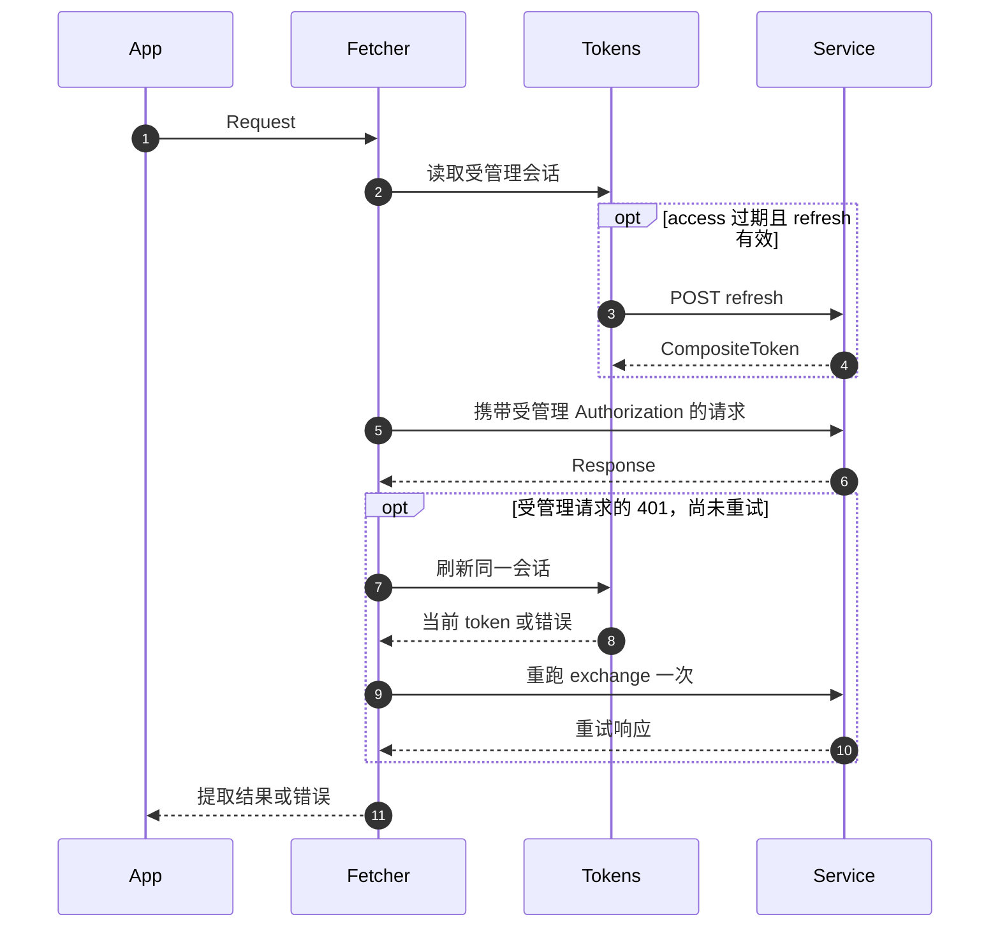

# 拦截器与资源归属

这些拦截器补充或重试 FetchExchange。通过对应 request、response 或 error manager 的 `.use(instance)` 注册。[配置器](./configuration)安装常见组合。

## 实际执行流程

1. CoSecRequestInterceptor 跳过被 [`isTrusted`](#request-trust) 拒绝的请求；否则设置设备与请求头（没有 `CoSec-App-Id`：CoSec 8.0 不读取它，应用是令牌的 `aud`），以及解析得到的真值空间 ID。刷新调用（带有 `Ignore-Refresh-Token` 的 exchange）从不带空间：它携带已过期的访问令牌，CoSec 会把它当作匿名，而声明了空间的匿名请求会被拒绝为 `401`（`SCP-3`）。空间每个 exchange 只解析一次：401 重试发往请求最初所属的空间，即使刷新期间当前空间已改变；之后的新请求使用当前空间。
2. AuthorizationRequestInterceptor 跳过不受信任的请求（不注入 Authorization、不刷新），并保留已有 Authorization；否则检查会话所有权，access 过期且 refresh 有效时刷新，再注入受管理的 Bearer token。没有 token 可发送的请求，同样出于上述原因，不发送 CoSec 请求拦截器设置的 `CoSec-Space-Id`。
3. ResourceAttributionRequestInterceptor 在 URL 解析前填充租户/所有者路径参数，占位符在请求实际解析所用的模板中查找：Fetcher `baseURL` 与请求 URL 拼接后的模板；请求 URL 为绝对地址时仅查找请求 URL。随后核心传输发送请求。
4. AuthorizationResponseInterceptor 在正常状态校验前处理受管理凭据的 401。被 `isTrusted` 拒绝的请求（未携带本应用凭据）的 401 原样返回：不刷新、不重放、不调用 onUnauthorized。对受管理的 401，先读取 [problem](#cosec-problems)：`unauthorized`（服务端没有看到凭据）不刷新；`token-revoked` 与 `token-invalid` 同样不刷新，因为会话已结束或凭据不被接受：若存储中仍是发出请求时的那对 token 就将其移除，由移除它的那个 exchange 负责通知。`token-expired` 以及没有 CoSec problem 的 401 继续往下：先释放未读取的 401 正文（避免其占用刷新与重试需要的连接），再刷新，仅删除自己注入的陈旧凭据，并完整重跑 exchange 管线，最多一次。重试自身的结果取代 401：重试的 fetch 失败（离线、超时、取消）时，请求以该错误失败，`exchange.response` 为 undefined，不调用 onUnauthorized。请求体为 `ReadableStream`（或其他异步可迭代对象）时无法再次发送：会话仍会刷新，请求以 `NonReplayableRequestError` 失败（不通知），由调用方用新的请求体重新发送。
5. 剩余失败进入错误拦截器。Unauthorized 通过通知所有权守卫处理 401/RefreshTokenError（`RefreshUnavailableError` 表示刷新没有给出裁决，会话保留，不通知），并传入 problem；Forbidden 处理 403，并把 `scope-rejected` 交给它自己的回调。`429`、`503`、`500` 与 `400` 两者都不触发：请求以状态错误拒绝，其 problem 可用 `getCoSecProblem` 读取。回调都不会自动恢复失败请求。

request/response manager 按 order 排序，注册顺序本身不是执行契约。重跑管线可能生成新的 CoSec 请求 ID。调用者提供的 Authorization 不会替换或自动刷新。access 已过期而 refresh 不可用时仍可能附加 token，由服务端决定响应状态。



## 拦截器参数与结果

| 导出                                                                   | 构造选项                                                                                                | intercept(exchange)                                                                                                                                                                                                |
| ---------------------------------------------------------------------- | ------------------------------------------------------------------------------------------------------- | ------------------------------------------------------------------------------------------------------------------------------------------------------------------------------------------------------------------ |
| `CoSecRequestInterceptor` / `CoSecRequestOptions`                      | 必填 deviceIdStorage；spaceIdProvider 默认 NoneSpaceIdProvider；可选 isTrusted；`appId` 已弃用并被忽略  | Promise&lt;void&gt;；不受信任的请求什么都不做；否则覆盖设备/请求头；仅为真值 ID 写空间头，刷新调用不写；存储/provider 失败传播                                                                                     |
| `AuthorizationRequestInterceptor` / `AuthorizationInterceptorOptions`  | 必填 tokenManager（JwtTokenManagerCapable）；可选 isTrusted                                             | Promise&lt;void&gt;；不受信任的请求什么都不做；保留显式 Authorization，需要时刷新受管理 token                                                                                                                      |
| `AuthorizationResponseInterceptor`                                     | 同 AuthorizationInterceptorOptions                                                                      | Promise&lt;void&gt;；仅受信任请求的 401、匹配受管理凭据，最多 AUTHORIZATION_RESPONSE_MAX_RETRY=1；`unauthorized`、`token-revoked`、`token-invalid` 不刷新；一次性请求体以 NonReplayableRequestError 失败           |
| `ResourceAttributionRequestInterceptor` / `ResourceAttributionOptions` | 必填 tokenStorage；tenantId='tenantId'、ownerId='ownerId' 是**占位符名称**                              | void；从解码的 access payload 取 tenantId/sub；仅当 baseURL + 请求 URL 模板（请求 URL 为绝对地址时仅请求 URL）包含该占位符且当前路径值为假值时填充                                                                 |
| `UnauthorizedErrorInterceptor` / options                               | 必填 onUnauthorized(exchange, problem?)，返回 void 或 Promise&lt;void&gt;                               | void 或 Promise&lt;void&gt;；跳过 RefreshSessionChangedError、RefreshUnavailableError、NonReplayableRequestError、被 `isTrusted` 拒绝的请求及重复/过时通知；回调错误成为 exchange 错误（`ExchangeError` 的 cause） |
| `ForbiddenErrorInterceptor` / options                                  | onForbidden(exchange, problem?) 与 onScopeRejected(exchange, problem)，均可选，返回 Promise&lt;void&gt; | Promise&lt;void&gt;；仅 response.status=403 时执行回调，已设置 onScopeRejected 时 `scope-rejected` 交给它；回调错误成为 exchange 错误（`ExchangeError` 的 cause）                                                  |

`IGNORE_REFRESH_TOKEN_ATTRIBUTE_KEY` 为 `Ignore-Refresh-Token`。只要属性**存在**（即使值为 false），就禁用主动/401 自动刷新。它不阻止 Authorization 注入，也不禁用普通 HTTP 状态错误。

## 请求信任 {#request-trust}

`RequestTrust` 为 `(url: string, exchange: FetchExchange) => boolean`；`RequestTrustCapable` 为 `CoSecConfig`、`CoSecRequestOptions` 与 `AuthorizationInterceptorOptions` 增加可选的 `isTrusted`。`isTrustedRequest(exchange, isTrusted?)` 为两个请求拦截器做判断：没有 `isTrusted` 时信任所有请求；有它时，相对请求 URL 与 `baseURL` 拼接后若仍在 `baseURL` 的协议与主机上则受信任，绝对 URL 仅在 `isTrusted(url, exchange)` 返回 true 时受信任。经 URL 解析会去往其他主机的相对 URL（`\host/path`、混合斜杠、或含解析器会删除的制表符与换行符）按绝对 URL 判断：`isTrusted` 收到它实际解析到的 URL（相对页面解析；没有页面时相对一个占位源）。该判断对每个 exchange（每个谓词）只做一次并保存在 exchange 上：401 重试时 URL 已按 `baseURL` 解析为绝对 URL，仍复用首次判断，因此受信任的相对请求在重试时保留凭据，且每个请求只调用一次 `isTrusted`。`sameOriginTrust` 信任 fetcher `baseURL` 所在源或页面自身源上的绝对 URL；其他源以及无法解析的 URL 都不受信任。

::: warning 默认信任所有源
默认情况下，任意源上的绝对请求 URL 都会收到访问 token 与 CoSec 请求头（含设备 ID）。客户端会请求不受你控制的 URL（如分页链接、下载地址、回调）时，请配置 `isTrusted: sameOriginTrust`（或自己的判断函数）。
:::

## 设备与空间选择

`DeviceIdStorage(options={})` 和 `SpaceIdStorage(options={})` 继承 KeyStorage&lt;string&gt;。选项为部分 KeyStorageOptions，每个类都强制使用自己的 identity serializer。默认键分别是 `cosec-device-id`、`cosec-space-id`，默认总线是以实际 key 命名的 serial 总线，仅当存储为浏览器 `localStorage` 时跨标签页广播，`destroy()` 会关闭这种默认总线；通过 `eventBus` 传入的总线保持打开。存储选择继承自 KeyStorage，可注入事件总线/存储；清理遵循 [KeyStorage](../storage/key-storage)。

`DeviceIdStorage.generateDeviceId(): string` 调用导出的 `idGenerator`，但不存储结果。`getOrCreate(): string` 返回已有真值 ID，否则生成并存储。`IdGenerator.generateId(): string` 由 `NanoIdGenerator` 使用 nanoid 实现，`idGenerator` 是共享实例。

`SpaceIdProvider.resolveSpaceId(exchange): string | null` 为同步方法。`NoneSpaceIdProvider` 始终返回 null。`DefaultSpaceIdProvider({ spacedResourcePredicate, spaceIdStorage })` 两者必填，调用 `SpacedResourcePredicate.test(exchange): boolean`，仅匹配时返回已存空间值。没有你的 predicate/storage 就不会自行从 URL 或 token 推断空间。

## 常量与鉴权数据

| 导出族                                                      | 值                                                                                                           |
| ----------------------------------------------------------- | ------------------------------------------------------------------------------------------------------------ |
| `COSEC_REQUEST_INTERCEPTOR_NAME/ORDER`                      | CoSecRequestInterceptor / Number.MIN_SAFE_INTEGER + DEFAULT_INTERCEPTOR_ORDER_STEP                           |
| `AUTHORIZATION_REQUEST_INTERCEPTOR_NAME/ORDER`              | AuthorizationRequestInterceptor / COSEC_REQUEST_INTERCEPTOR_ORDER + DEFAULT_INTERCEPTOR_ORDER_STEP           |
| `AUTHORIZATION_RESPONSE_INTERCEPTOR_NAME/ORDER`             | AuthorizationResponseInterceptor / Number.MIN_SAFE_INTEGER + 1000                                            |
| `RESOURCE_ATTRIBUTION_REQUEST_INTERCEPTOR_NAME/ORDER`       | ResourceAttributionRequestInterceptor / URL_RESOLVE_INTERCEPTOR_ORDER - DEFAULT_INTERCEPTOR_ORDER_STEP       |
| `UNAUTHORIZED_ERROR_INTERCEPTOR_NAME/ORDER`                 | UnauthorizedErrorInterceptor / 0                                                                             |
| `FORBIDDEN_ERROR_INTERCEPTOR_NAME/ORDER`                    | ForbiddenErrorInterceptor / 0                                                                                |
| `DEFAULT_COSEC_DEVICE_ID_KEY`、`DEFAULT_COSEC_SPACE_ID_KEY` | cosec-device-id、cosec-space-id                                                                              |
| `CoSecHeaders` 静态字段                                     | DEVICE_ID=CoSec-Device-Id、SPACE_ID=CoSec-Space-Id、AUTHORIZATION=Authorization、REQUEST_ID=CoSec-Request-Id |
| `ResponseCodes`                                             | UNAUTHORIZED=401、FORBIDDEN=403、TOO_MANY_REQUESTS=429                                                       |

## CoSec problem {#cosec-problems}

CoSec 8.0 把每次拒绝都回答为 `application/problem+json`：`type`（`https://cosec.ahoo.me/problems/<slug>`）、`title`、`status`、`code`（大写下划线形式的 slug）、`requestId`（等于响应头 `CoSec-Request-Id`），以及追踪捕获到时的 `traceId`，没有别的成员。包从响应正文的副本中读取它（`readCoSecProblem(response)`），或从状态校验抛出的错误中读取（`getCoSecProblem(error)`）；`CoSecProblem.slug` 是 `type` 的最后一段。依据 slug 判断，不要依据 `title`；这个集合会随 CoSec 的次版本增长，所以 `slug` 可能是 `CoSecProblemType` 未列出的类型。不是 `application/problem+json`、或 `type` 不属于 CoSec 的响应，没有 CoSec problem。

| `CoSecProblemType`  | Slug                | 状态 | 客户端的做法                                                                 |
| ------------------- | ------------------- | ---- | ---------------------------------------------------------------------------- |
| `INVALID_REQUEST`   | `invalid-request`   | 400  | 什么都不做；这是请求本身的缺陷。会话保留。                                   |
| `UNAUTHORIZED`      | `unauthorized`      | 401  | 不刷新（服务端没有看到凭据）；`onUnauthorized`                               |
| `TOKEN_EXPIRED`     | `token-expired`     | 401  | 刷新一次并重试一次                                                           |
| `TOKEN_REVOKED`     | `token-revoked`     | 401  | 不刷新；移除这对 token；`onUnauthorized`                                     |
| `TOKEN_INVALID`     | `token-invalid`     | 401  | 不刷新；移除这对 token；`onUnauthorized`                                     |
| `FORBIDDEN`         | `forbidden`         | 403  | `onForbidden`                                                                |
| `SCOPE_REJECTED`    | `scope-rejected`    | 403  | `onScopeRejected`，否则 `onForbidden`。客户端不会丢弃空间或退回默认空间。    |
| `TOO_MANY_REQUESTS` | `too-many-requests` | 429  | 什么都不做；绝不退出登录。`retryAfterSeconds(response)` 读取 `Retry-After`。 |
| `UNAVAILABLE`       | `unavailable`       | 503  | 什么都不做；会话保留                                                         |
| `INTERNAL_ERROR`    | `internal-error`    | 500  | 什么都不做                                                                   |

`COSEC_PROBLEM_TYPE_PREFIX` 是 `type` 的前缀。`retryAfterSeconds(response, now?)` 把 `Retry-After` 读为整数秒或 HTTP 日期。`CoSecProblem` 含 `slug`、`type`、`title?`、`status?`、`code?`、`requestId?`、`traceId?`。

## 完整空间配置

```ts
import { Fetcher } from '@ahoo-wang/fetcher';
import {
  CoSecConfigurer,
  DefaultSpaceIdProvider,
  SpaceIdStorage,
  TokenStorage,
  DeviceIdStorage,
} from '@ahoo-wang/fetcher-cosec';
import { InMemoryStorage } from '@ahoo-wang/fetcher-storage';
import { SerialTypedEventBus } from '@ahoo-wang/fetcher-eventbus';

const spaces = new SpaceIdStorage({
  storage: new InMemoryStorage(),
  eventBus: new SerialTypedEventBus('example-space'),
});
spaces.set('workspace-1');
const provider = new DefaultSpaceIdProvider({
  spaceIdStorage: spaces,
  spacedResourcePredicate: {
    test: exchange => exchange.request.url.startsWith('/projects'),
  },
});
const fetcher = new Fetcher({ baseURL: 'https://api.example.com' });
const cosec = new CoSecConfigurer({
  spaceIdProvider: provider,
  tokenStorage: new TokenStorage({
    storage: new InMemoryStorage(),
    eventBus: new SerialTypedEventBus('example-token'),
  }),
  deviceIdStorage: new DeviceIdStorage({
    storage: new InMemoryStorage(),
    eventBus: new SerialTypedEventBus('example-device'),
  }),
});
cosec.applyTo(fetcher);
// 构造配置本身不发送请求。
spaces.destroy();
cosec.tokenStorage.destroy();
cosec.deviceIdStorage.destroy();
```

<span id="authorizationinterceptoroptions"></span>

**`AuthorizationInterceptorOptions`** — [packages/cosec/src/authorizationRequestInterceptor.ts:37](https://github.com/Ahoo-Wang/fetcher/blob/main/packages/cosec/src/authorizationRequestInterceptor.ts#L37)

<span id="authorization_request_interceptor_name"></span>

**`AUTHORIZATION_REQUEST_INTERCEPTOR_NAME`** — [packages/cosec/src/authorizationRequestInterceptor.ts:40](https://github.com/Ahoo-Wang/fetcher/blob/main/packages/cosec/src/authorizationRequestInterceptor.ts#L40)

<span id="authorization_request_interceptor_order"></span>

**`AUTHORIZATION_REQUEST_INTERCEPTOR_ORDER`** — [packages/cosec/src/authorizationRequestInterceptor.ts:42](https://github.com/Ahoo-Wang/fetcher/blob/main/packages/cosec/src/authorizationRequestInterceptor.ts#L42)

<span id="authorizationrequestinterceptor"></span>

**`AuthorizationRequestInterceptor`** — [packages/cosec/src/authorizationRequestInterceptor.ts:55](https://github.com/Ahoo-Wang/fetcher/blob/main/packages/cosec/src/authorizationRequestInterceptor.ts#L55)

<span id="authorization_response_interceptor_name"></span>

**`AUTHORIZATION_RESPONSE_INTERCEPTOR_NAME`** — [packages/cosec/src/authorizationResponseInterceptor.ts:43](https://github.com/Ahoo-Wang/fetcher/blob/main/packages/cosec/src/authorizationResponseInterceptor.ts#L43)

<span id="authorization_response_interceptor_order"></span>

**`AUTHORIZATION_RESPONSE_INTERCEPTOR_ORDER`** — [packages/cosec/src/authorizationResponseInterceptor.ts:50](https://github.com/Ahoo-Wang/fetcher/blob/main/packages/cosec/src/authorizationResponseInterceptor.ts#L50)

<span id="authorization_response_max_retry"></span>

**`AUTHORIZATION_RESPONSE_MAX_RETRY`** — [packages/cosec/src/authorizationResponseInterceptor.ts:59](https://github.com/Ahoo-Wang/fetcher/blob/main/packages/cosec/src/authorizationResponseInterceptor.ts#L59)

<span id="authorizationresponseinterceptor"></span>

**`AuthorizationResponseInterceptor`** — [packages/cosec/src/authorizationResponseInterceptor.ts:78](https://github.com/Ahoo-Wang/fetcher/blob/main/packages/cosec/src/authorizationResponseInterceptor.ts#L78)

<span id="nonreplayablerequesterror"></span>

**`NonReplayableRequestError`** — [packages/cosec/src/errors.ts:79](https://github.com/Ahoo-Wang/fetcher/blob/main/packages/cosec/src/errors.ts#L79)

<span id="cosecrequestoptions"></span>

**`CoSecRequestOptions`** — [packages/cosec/src/cosecRequestInterceptor.ts:63](https://github.com/Ahoo-Wang/fetcher/blob/main/packages/cosec/src/cosecRequestInterceptor.ts#L63)

<span id="cosec_request_interceptor_name"></span>

**`COSEC_REQUEST_INTERCEPTOR_NAME`** — [packages/cosec/src/cosecRequestInterceptor.ts:89](https://github.com/Ahoo-Wang/fetcher/blob/main/packages/cosec/src/cosecRequestInterceptor.ts#L89)

<span id="cosec_request_interceptor_order"></span>

**`COSEC_REQUEST_INTERCEPTOR_ORDER`** — [packages/cosec/src/constants.ts:46](https://github.com/Ahoo-Wang/fetcher/blob/main/packages/cosec/src/constants.ts#L46)

<span id="ignore_refresh_token_attribute_key"></span>

**`IGNORE_REFRESH_TOKEN_ATTRIBUTE_KEY`** — [packages/cosec/src/constants.ts:73](https://github.com/Ahoo-Wang/fetcher/blob/main/packages/cosec/src/constants.ts#L73)

<span id="cosecrequestinterceptor"></span>

**`CoSecRequestInterceptor`** — [packages/cosec/src/cosecRequestInterceptor.ts:178](https://github.com/Ahoo-Wang/fetcher/blob/main/packages/cosec/src/cosecRequestInterceptor.ts#L178)

<span id="requesttrust"></span>

**`RequestTrust`** — [packages/cosec/src/requestTrust.ts:32](https://github.com/Ahoo-Wang/fetcher/blob/main/packages/cosec/src/requestTrust.ts#L32)

<span id="requesttrustcapable"></span>

**`RequestTrustCapable`** — [packages/cosec/src/requestTrust.ts:34](https://github.com/Ahoo-Wang/fetcher/blob/main/packages/cosec/src/requestTrust.ts#L34)

<span id="sameorigintrust"></span>

**`sameOriginTrust`** — [packages/cosec/src/requestTrust.ts:98](https://github.com/Ahoo-Wang/fetcher/blob/main/packages/cosec/src/requestTrust.ts#L98)

<span id="istrustedrequest"></span>

**`isTrustedRequest`** — [packages/cosec/src/requestTrust.ts:114](https://github.com/Ahoo-Wang/fetcher/blob/main/packages/cosec/src/requestTrust.ts#L114)

<span id="default_cosec_device_id_key"></span>

**`DEFAULT_COSEC_DEVICE_ID_KEY`** — [packages/cosec/src/deviceIdStorage.ts:22](https://github.com/Ahoo-Wang/fetcher/blob/main/packages/cosec/src/deviceIdStorage.ts#L22)

<span id="deviceidstorageoptions"></span>

**`DeviceIdStorageOptions`** — [packages/cosec/src/deviceIdStorage.ts:25](https://github.com/Ahoo-Wang/fetcher/blob/main/packages/cosec/src/deviceIdStorage.ts#L25)

<span id="deviceidstorage"></span>

**`DeviceIdStorage`** — [packages/cosec/src/deviceIdStorage.ts:32](https://github.com/Ahoo-Wang/fetcher/blob/main/packages/cosec/src/deviceIdStorage.ts#L32)

<span id="idgenerator"></span>

**`IdGenerator`** — [packages/cosec/src/idGenerator.ts:16](https://github.com/Ahoo-Wang/fetcher/blob/main/packages/cosec/src/idGenerator.ts#L16)

<span id="nanoidgenerator"></span>

**`NanoIdGenerator`** — [packages/cosec/src/idGenerator.ts:24](https://github.com/Ahoo-Wang/fetcher/blob/main/packages/cosec/src/idGenerator.ts#L24)

<span id="idgenerator-instance"></span>

**`idGenerator`** — [packages/cosec/src/idGenerator.ts:35](https://github.com/Ahoo-Wang/fetcher/blob/main/packages/cosec/src/idGenerator.ts#L35)

<span id="resourceattributionoptions"></span>

**`ResourceAttributionOptions`** — [packages/cosec/src/resourceAttributionRequestInterceptor.ts:29](https://github.com/Ahoo-Wang/fetcher/blob/main/packages/cosec/src/resourceAttributionRequestInterceptor.ts#L29)

<span id="resource_attribution_request_interceptor_name"></span>

**`RESOURCE_ATTRIBUTION_REQUEST_INTERCEPTOR_NAME`** — [packages/cosec/src/resourceAttributionRequestInterceptor.ts:47](https://github.com/Ahoo-Wang/fetcher/blob/main/packages/cosec/src/resourceAttributionRequestInterceptor.ts#L47)

<span id="resource_attribution_request_interceptor_order"></span>

**`RESOURCE_ATTRIBUTION_REQUEST_INTERCEPTOR_ORDER`** — [packages/cosec/src/resourceAttributionRequestInterceptor.ts:55](https://github.com/Ahoo-Wang/fetcher/blob/main/packages/cosec/src/resourceAttributionRequestInterceptor.ts#L55)

<span id="resourceattributionrequestinterceptor"></span>

**`ResourceAttributionRequestInterceptor`** — [packages/cosec/src/resourceAttributionRequestInterceptor.ts:63](https://github.com/Ahoo-Wang/fetcher/blob/main/packages/cosec/src/resourceAttributionRequestInterceptor.ts#L63)

<span id="spaceidprovider"></span>

**`SpaceIdProvider`** — [packages/cosec/src/spaceIdProvider.ts:67](https://github.com/Ahoo-Wang/fetcher/blob/main/packages/cosec/src/spaceIdProvider.ts#L67)

<span id="nonespaceidprovider"></span>

**`NoneSpaceIdProvider`** — [packages/cosec/src/spaceIdProvider.ts:122](https://github.com/Ahoo-Wang/fetcher/blob/main/packages/cosec/src/spaceIdProvider.ts#L122)

<span id="default_cosec_space_id_key"></span>

**`DEFAULT_COSEC_SPACE_ID_KEY`** — [packages/cosec/src/spaceIdProvider.ts:133](https://github.com/Ahoo-Wang/fetcher/blob/main/packages/cosec/src/spaceIdProvider.ts#L133)

<span id="spaceidstorageoptions"></span>

**`SpaceIdStorageOptions`** — [packages/cosec/src/spaceIdProvider.ts:168](https://github.com/Ahoo-Wang/fetcher/blob/main/packages/cosec/src/spaceIdProvider.ts#L168)

<span id="spaceidstorage"></span>

**`SpaceIdStorage`** — [packages/cosec/src/spaceIdProvider.ts:209](https://github.com/Ahoo-Wang/fetcher/blob/main/packages/cosec/src/spaceIdProvider.ts#L209)

<span id="spacedresourcepredicate"></span>

**`SpacedResourcePredicate`** — [packages/cosec/src/spaceIdProvider.ts:288](https://github.com/Ahoo-Wang/fetcher/blob/main/packages/cosec/src/spaceIdProvider.ts#L288)

<span id="spaceidprovideroptions"></span>

**`SpaceIdProviderOptions`** — [packages/cosec/src/spaceIdProvider.ts:317](https://github.com/Ahoo-Wang/fetcher/blob/main/packages/cosec/src/spaceIdProvider.ts#L317)

<span id="defaultspaceidprovider"></span>

**`DefaultSpaceIdProvider`** — [packages/cosec/src/spaceIdProvider.ts:373](https://github.com/Ahoo-Wang/fetcher/blob/main/packages/cosec/src/spaceIdProvider.ts#L373)

<span id="cosecheaders"></span>

**`CoSecHeaders`** — [packages/cosec/src/types.ts:20](https://github.com/Ahoo-Wang/fetcher/blob/main/packages/cosec/src/types.ts#L20)

<span id="responsecodes"></span>

**`ResponseCodes`** — [packages/cosec/src/types.ts:27](https://github.com/Ahoo-Wang/fetcher/blob/main/packages/cosec/src/types.ts#L27)

<span id="unauthorized_error_interceptor_name"></span>

**`UNAUTHORIZED_ERROR_INTERCEPTOR_NAME`** — [packages/cosec/src/constants.ts:23](https://github.com/Ahoo-Wang/fetcher/blob/main/packages/cosec/src/constants.ts#L23)

<span id="unauthorized_error_interceptor_order"></span>

**`UNAUTHORIZED_ERROR_INTERCEPTOR_ORDER`** — [packages/cosec/src/unauthorizedErrorInterceptor.ts:37](https://github.com/Ahoo-Wang/fetcher/blob/main/packages/cosec/src/unauthorizedErrorInterceptor.ts#L37)

<span id="unauthorizederrorinterceptoroptions"></span>

**`UnauthorizedErrorInterceptorOptions`** — [packages/cosec/src/unauthorizedErrorInterceptor.ts:42](https://github.com/Ahoo-Wang/fetcher/blob/main/packages/cosec/src/unauthorizedErrorInterceptor.ts#L42)

<span id="unauthorizederrorinterceptor"></span>

**`UnauthorizedErrorInterceptor`** — [packages/cosec/src/unauthorizedErrorInterceptor.ts:85](https://github.com/Ahoo-Wang/fetcher/blob/main/packages/cosec/src/unauthorizedErrorInterceptor.ts#L85)

<span id="forbidden_error_interceptor_name"></span>

**`FORBIDDEN_ERROR_INTERCEPTOR_NAME`** — [packages/cosec/src/forbiddenErrorInterceptor.ts:26](https://github.com/Ahoo-Wang/fetcher/blob/main/packages/cosec/src/forbiddenErrorInterceptor.ts#L26)

<span id="forbidden_error_interceptor_order"></span>

**`FORBIDDEN_ERROR_INTERCEPTOR_ORDER`** — [packages/cosec/src/forbiddenErrorInterceptor.ts:32](https://github.com/Ahoo-Wang/fetcher/blob/main/packages/cosec/src/forbiddenErrorInterceptor.ts#L32)

<span id="forbiddenerrorinterceptoroptions"></span>

**`ForbiddenErrorInterceptorOptions`** — [packages/cosec/src/forbiddenErrorInterceptor.ts:37](https://github.com/Ahoo-Wang/fetcher/blob/main/packages/cosec/src/forbiddenErrorInterceptor.ts#L37)

<span id="forbiddenerrorinterceptor"></span>

**`ForbiddenErrorInterceptor`** — [packages/cosec/src/forbiddenErrorInterceptor.ts:141](https://github.com/Ahoo-Wang/fetcher/blob/main/packages/cosec/src/forbiddenErrorInterceptor.ts#L141)

<span id="cosec_problem_type_prefix"></span>

**`COSEC_PROBLEM_TYPE_PREFIX`** — [packages/cosec/src/problem.ts:25](https://github.com/Ahoo-Wang/fetcher/blob/main/packages/cosec/src/problem.ts#L25)

<span id="cosecproblemtype"></span>

**`CoSecProblemType`** — [packages/cosec/src/problem.ts:34](https://github.com/Ahoo-Wang/fetcher/blob/main/packages/cosec/src/problem.ts#L34)

<span id="cosecproblemslug"></span>

**`CoSecProblemSlug`** — [packages/cosec/src/problem.ts:57](https://github.com/Ahoo-Wang/fetcher/blob/main/packages/cosec/src/problem.ts#L57)

<span id="cosecproblem"></span>

**`CoSecProblem`** — [packages/cosec/src/problem.ts:64](https://github.com/Ahoo-Wang/fetcher/blob/main/packages/cosec/src/problem.ts#L64)

<span id="readcosecproblem"></span>

**`readCoSecProblem`** — [packages/cosec/src/problem.ts:120](https://github.com/Ahoo-Wang/fetcher/blob/main/packages/cosec/src/problem.ts#L120)

<span id="getcosecproblem"></span>

**`getCoSecProblem`** — [packages/cosec/src/problem.ts:132](https://github.com/Ahoo-Wang/fetcher/blob/main/packages/cosec/src/problem.ts#L132)

<span id="retryafterseconds"></span>

**`retryAfterSeconds`** — [packages/cosec/src/problem.ts:184](https://github.com/Ahoo-Wang/fetcher/blob/main/packages/cosec/src/problem.ts#L184)
